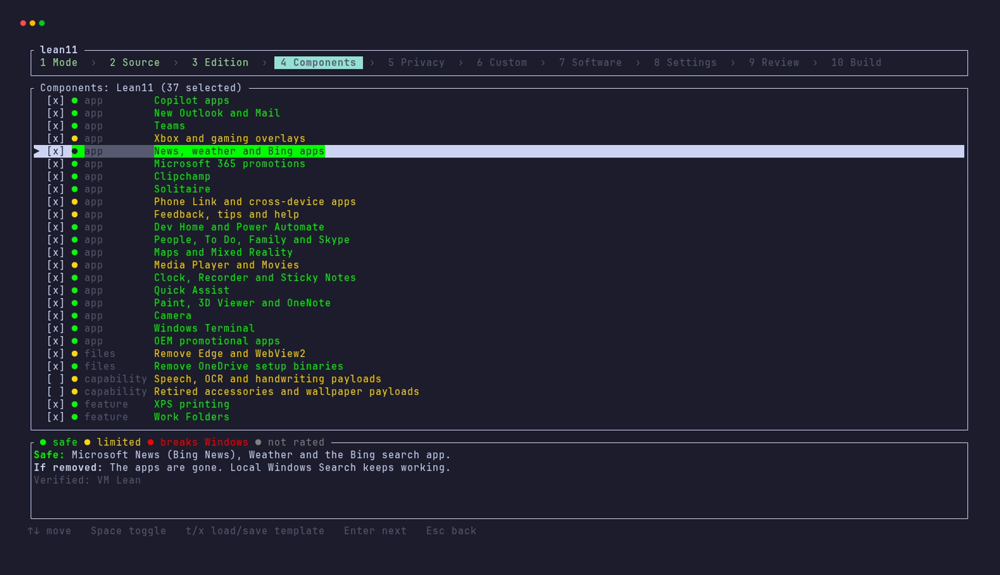
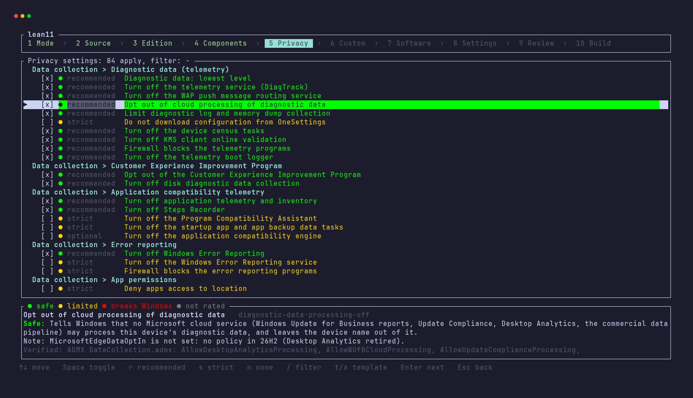
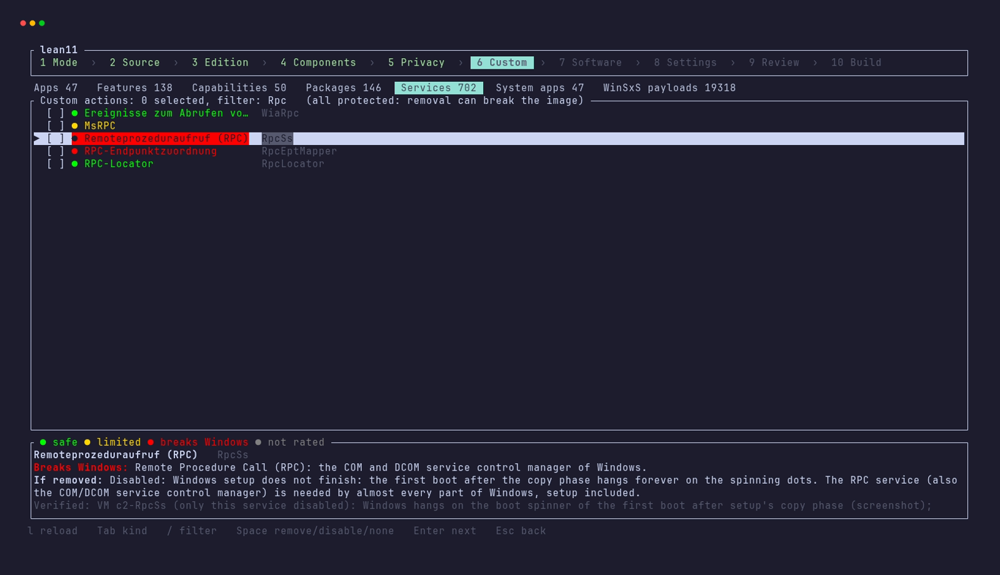
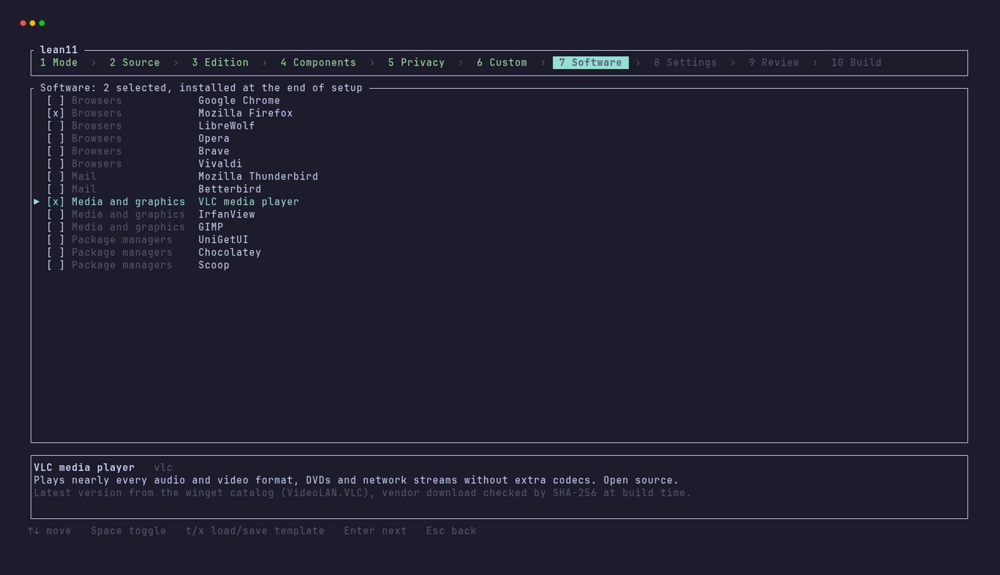
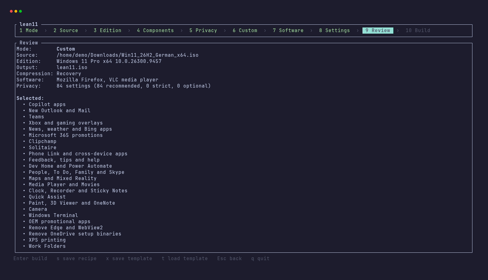
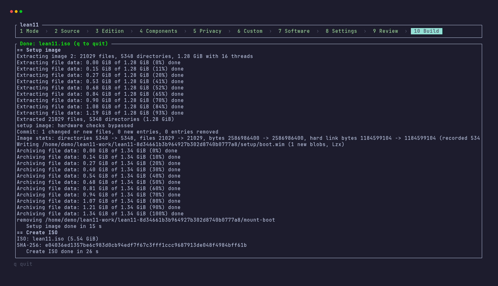

# lean11

> **A note from the author**
>
> lean11 was mentioned by Mental Outlaw in his video
> [Using tiny11builder to Debloat Windows 11](https://www.youtube.com/watch?v=1-GlnimDG3I), and since then a lot of
> you have found your way here. I'm really glad about that: thank you for the stars, the issues and all the
> feedback.
>
> Since it came up in the comments: yes, lean11 was built with heavy help from AI. That is what makes it possible
> for me to build and maintain a project like this next to my day job. It does not mean nobody looks at it: I keep
> an eye on the quality and the behavior of the app, and every single feature has been tested by a human (me)
> before it ships. On top of that, every removable item is rated by real test installs (see
> [docs/KNOWLEDGE.md](docs/KNOWLEDGE.md)). If something does not work for you, please open an issue.
>
> And yes, I know: RUST! RUST IS THE BEST!!!!!1111eleven! Joking aside, it is Rust for purely pragmatic reasons:
> one code base that runs on Windows, Linux and macOS. I first planned to write it in Python, but it would have
> grown too big, and porting it to all three major operating systems would have been too much work. So it is Rust
> from the ground up. Also, nobody wants Java. *scnr*

Build trimmed, private Windows 11 ISOs on Linux, macOS and Windows, without DISM or a VM: remove bundled apps
and features, apply a verified catalog of privacy settings, add custom removals from the image's full inventory,
reuse your choice as a template. The DISM, CBS and Appx operations it needs are reimplemented natively (offline
servicing store, component manifests, provisioned apps, offline registry, Task Scheduler cache).

The interface is a CLI and a terminal wizard (TUI).


*The wizard on a real Windows 11 26H2 ISO: pick the build, the edition, components, privacy settings, custom
removals and extra software, then build. The waits for the image inventory and the build (about 30 minutes) are
cut out.*

## What it looks like

Every removable item carries a traffic-light rating with what it is, what happens without it and how that was
verified: **green** only the item goes, **yellow** other functions are affected, **red** setup or Windows breaks
(proven by a test install). See [docs/KNOWLEDGE.md](docs/KNOWLEDGE.md).

<table>
<tr>
<td width="50%"><br>
<b>Components.</b> The bundled apps and features lean11 removes, each with its rating and the effect of removing
it.</td>
<td width="50%"><br>
<b>Privacy.</b> A curated catalog of settings (telemetry, ads, app permissions, ...) with their documentation;
<code>r</code> selects all recommended ones.</td>
</tr>
<tr>
<td><br>
<b>Custom.</b> The full inventory of the chosen edition: apps, features, capabilities, packages, services and
drivers, system apps. Names come from the image (a German ISO here); red items break Windows.</td>
<td><br>
<b>Software.</b> Programs installed at the end of setup, in their latest version from the winget catalog and checked
by SHA-256.</td>
</tr>
<tr>
<td><br>
<b>Review.</b> Everything that will happen, before anything is written.</td>
<td><br>
<b>Build.</b> The image is extracted, serviced natively and written back; the ISO comes with its SHA-256.</td>
</tr>
</table>

## Install

Download the archive for your system from the [releases page](../../releases) and unpack it:

| System | Archive |
| --- | --- |
| Linux x86_64 | `lean11-<version>-linux-x86_64.tar.gz` |
| macOS (Apple Silicon) | `lean11-<version>-macos-arm64.tar.gz` |
| Windows 10/11 x64 | `lean11-<version>-windows-x64.zip` |

Each archive holds one self-contained binary and a `.sha256` file lies next to it. On macOS, remove the download
quarantine once (`xattr -d com.apple.quarantine lean11`) or allow it under System Settings, Privacy & Security.

Or build it yourself, see [Build from source](#build-from-source).

On Windows, `lean11.exe` needs no installer and no administrator rights. Run it in Windows Terminal or
PowerShell (`lean11.exe tui`, `lean11.exe build …`). The working folder must be on NTFS (hard links); Defender
scans the extracted image, so a build takes about twice as long as on Linux (about 35 min for Lean in a VM).
Verified 26.10.2026: built on Windows 11 26H2, the ISO installs and passes all 232 checks of its privacy settings.

lean11 is one self-contained binary: WIM/ESD reading, extraction and writing (`lean11-wim`, with wimlib's
compressors translated to Rust in `lean11-codecs`), the offline registry (`lean11-hive`), UDF/ISO (`lean11-iso`) and
the Microsoft download (`lean11-msdl`) are built in. wimlib (`wimtools` / `wimlib`) and FUSE 3 are only needed
for the fallback `LEAN11_WIMLIB=1`, which uses `wimlib-imagex` and FUSE mounts instead (and needs root).

## Use

Building does not need root: the image is extracted into the job folder (real hard links), edited there and
written back. The working folder needs room for the extracted image (about 15 GiB for Windows 11 Pro) besides
the WIM files. Its file system must allow file names of 255 characters and hard links, and it cannot be FAT or
exFAT. An encrypted home folder with eCryptfs (for example Linux Mint's "encrypt home") only allows 143 characters:
put the working folder elsewhere with `--work` (or "Working directory" in the TUI settings), e.g. `/var/tmp`.
lean11 checks this before it starts.

```sh
lean11 tui                                   # wizard: mode, source/download, edition, components, privacy, custom, software, settings
lean11 download --lang de-DE --out ~/iso          # latest Windows 11 ISO from Microsoft (x64; --arch arm64 for ARM PCs)
lean11 build Win11.iso --out lean11.iso      # Lean11 (serviceable), recovery ESD
lean11 build Win11.iso --mode core --accept-core --out lean11-core.iso
lean11 build Win11.iso --mode custom --enable clipchamp --core --accept-core --turbo --out custom.iso
lean11 build Win11.iso --mode custom --ssh-key ~/.ssh/id_ed25519.pub --out remote.iso   # SSH as Administrator after setup
lean11 build --resume <work>/lean11-<id>     # continue a stopped job (verified saved progress)
lean11 recover <work> [--discard]            # interrupted jobs: remove leftover workspaces, discard working copies
lean11 catalog --mode lean                      # what a mode removes or changes
lean11 inventory Win11.iso --kind feature    # full image inventory (apps, features, capabilities, ...)
```

With `--ssh-key` (Custom) the installed Windows runs an OpenSSH server on port 22 right after setup: log in with
`ssh Administrator@<host>` and the key; the session is a fully elevated administrator with PowerShell, and
`Invoke-AsSystem '<command>'` runs a command as SYSTEM (for files and keys owned by TrustedInstaller). Microsoft
Defender still scans what you run unless you add `--enable disable-defender`. Several machines can log in:
repeat `--ssh-key`, or give a file with one key per line like `authorized_keys` (in the TUI as well). The server is
set up at the end of setup, or at the first sign-in on PCs with an OEM product key in the firmware (Windows skips
the end-of-setup script there).

Core's four parts are also single Custom options: `disable-defender` and `disable-windows-update` are reversible
and keep the image serviceable; `remove-winre` and `trim-winsxs` are irreversible and need `--accept-core`
(in the TUI a confirmation). Both switch setup to the legacy installer: the current one needs the recovery image
and fails without it. Example, only Defender off:
`lean11 build Win11.iso --mode lean --enable disable-defender --out lean11-nodefender.iso`.

### Privacy settings

lean11 brings its own catalog of more than 160 privacy, telemetry and hardening settings (telemetry, app
permissions, search, ads, AI features, Defender data sharing, hosts blocking, firewall, Explorer, browsers, Office,
TLS and more). Every setting is verified against the image's own
ADMX templates, Microsoft's documentation or a test install, and settings for removed components are hidden
(no Edge settings when Edge is removed, no Defender settings when Defender is off). Details and the catalog
format: [docs/PRIVACY.md](docs/PRIVACY.md).

```sh
lean11 privacy list --preset recommended     # what a preset contains (levels: recommended, strict, optional)
lean11 build Win11.iso --privacy recommended --out private.iso
lean11 build Win11.iso --privacy strict --privacy-enable hibernation-off --privacy-disable search-web-off --out strict.iso
```

In the TUI the Privacy step comes after Components: Space toggles a setting (on a category heading: the
category), `r`, `s`, `n` pick the presets recommended, strict or none, `/` filters. Privacy settings build as
Custom, like `--ssh-key`.

### Ratings

Every Components option, privacy setting and (as the knowledge base grows) every inventory item carries a rating,
shown as a colored dot in the TUI together with what the item is, what removing it does and the evidence:

| Dot | Meaning |
|---|---|
| green (safe) | Setup and Windows keep working; only the named item goes, nothing else depends on it. |
| yellow (limited) | Setup and Windows keep working, but other functions or apps that build on it are impaired. |
| red (breaks) | Setup or Windows itself fails (proven by a test install or documented by Microsoft). |
| grey | Not rated yet. |

The ratings live in `crates/lean11-core/data/knowledge.toml`; format: [docs/KNOWLEDGE.md](docs/KNOWLEDGE.md).

### Additional software

Programs can be added to the image and are installed silently and machine-wide at the end of setup: Google Chrome,
Firefox, LibreWolf, Opera, Brave, Vivaldi, Thunderbird, Betterbird, VLC, IrfanView, GIMP, UniGetUI, Chocolatey,
Scoop and Vibepollo. The build takes the latest version from the winget catalog (the same source Windows' `winget`
uses), downloads the installer from the vendor and checks its SHA-256; setup checks it again before running it.
Vibepollo is not in winget: it comes from its latest stable GitHub release, checked against the SHA-256 GitHub
records for the file. Firefox,
Thunderbird and Betterbird come in the image language where available. Scoop installs per account: it is set up
at sign-in and needs internet then (retried at every sign-in until it succeeds). The result is logged to
`C:\Windows\Logs\lean11-software.log`.

```sh
lean11 software list
lean11 software resolve --lang de-DE         # versions, installers and URLs the build would use
lean11 build Win11.iso --mode custom --software firefox,vlc,gimp --out apps.iso
```

In the TUI the Software step comes after Custom. Additional software builds as Custom.

### Templates

A template stores your whole choice without the ISO, edition and output: mode, Components options, privacy
settings, custom actions and settings (compression, account, SSH key, …). Apply it to any ISO, also a newer one:
custom actions are matched to that image by name without version, and what does not exist there is reported
and skipped.

```sh
lean11 build --mode lean --privacy strict --enable disable-defender --save-template mine.json   # no ISO needed
lean11 build Win11.iso --template mine.json --out lean11.iso
lean11 build Win11.iso --template mine.json --privacy-disable hibernation-off --out lean11.iso    # flags change it
```

In the TUI `t` loads and `x` saves a template (in the Mode, Components, Privacy, Settings and Review steps). A
recipe (`s` in Review) is different: it records one build including source and output. A recipe file can also be
loaded as a template. When the ISO a recipe names is missing (a recipe from another machine), lean11 takes the
same file from its downloads folder or offers to download it (language and architecture from the file name);
`lean11 build NEW.iso --recipe recipe.json` uses another ISO.

The image inventory for custom actions is read in the background as soon as the edition is chosen (it takes a
few minutes); `l` in the Custom step reads it again.

Each build keeps `job.json`, `recipe.json`, `build.log`, `report.json`, `operations.json` and `timings.json` in
its job folder. Core images cannot be updated or serviced: use them only in test VMs.

### USB stick

lean11 writes a bootable installation stick itself, no Rufus or Ventoy needed: right after a build, instead of
the ISO, or from any Windows 11 ISO (also an untouched one from Microsoft).

```sh
lean11 usb --list                            # drives that can be written (USB and removable only)
lean11 usb lean11.iso                        # pick the drive, confirm, write and check
lean11 usb Win11.iso --device /dev/sdb       # any Windows 11 ISO or media folder; macOS /dev/disk4, Windows \\.\PhysicalDrive2
lean11 usb lean11.iso --image stick.img      # a disk image instead of a drive (for VMs or dd)
lean11 build Win11.iso --out lean11.iso --usb             # ISO and stick (the drive is chosen before the build)
lean11 build Win11.iso --usb /dev/sdb --usb-only          # only the stick, no ISO file
```

After a build in a terminal lean11 also asks whether to write the new ISO to a stick. In the TUI, Settings has
"Output" (ISO file, USB stick only, or both) and "USB stick"; after an ISO build `u` writes it.

- The stick boots on UEFI (Secure Boot stays on, the loaders are Microsoft-signed) and on legacy BIOS: one active
  FAT32 partition in an MBR table, only as large as the files need. The BIOS boot code is taken from
  `boot\bootsect.exe` of the medium itself.
- FAT32 holds no file larger than 4 GiB. A larger `install.wim` is split into `install.swm`, `install2.swm`, ...
  (Setup reads split images directly); a larger `install.esd` is first converted to an LZX WIM, which takes a few
  minutes.
- Everything written is read back and compared by SHA-256 (`--no-verify` skips it).
- Only USB or removable drives are offered, never the system disk. lean11 shows the drive with its partitions and
  asks before it erases anything (`--yes` skips the question).
- lean11 itself runs without root: only the small step that writes the drive asks for administrator rights
  (`sudo` or `pkexec` on Linux, `sudo` on macOS, the UAC prompt on Windows). The TUI leaves the full-screen view
  for that moment.
- A mounted Ventoy stick is recognized: lean11 offers to copy the ISO onto it instead of erasing it
  (`--no-ventoy` erases it).

## Build from source

Requirements: Rust 1.96 or newer (rustup) and a C compiler (for the TLS library). There are no
runtime dependencies; `wimtools` and `fuse3` are only needed for the fallback `LEAN11_WIMLIB=1`.

```sh
cargo build --release --locked
```

### Container

The [Containerfile](Containerfile) builds lean11 in a container and runs it in a small Debian image (about
100 MB), with Podman or Docker. Mount a folder for the source ISO, the output and the working copy (about
40 GiB free on a file system with hard links and 255-character names):

```sh
podman build -t lean11 .                     # docker build -t lean11 -f Containerfile .
podman run --rm -it -v "$PWD:/data" lean11 download --lang en-US --out /data
podman run --rm -it -v "$PWD:/data" lean11 build /data/Win11_26H2_English_x64.iso --out /data/lean11.iso
podman run --rm -it -v "$PWD:/data" lean11 tui
```

With Docker add `--user "$(id -u):$(id -g)"` so the files belong to you.

### GitHub Actions

Fork this repository, open **Actions**, choose **build-iso** and **Run workflow**: pick the language, edition,
mode (or a template from your fork) and compression. The workflow downloads Windows 11 from Microsoft, builds it
with the latest lean11 release and uploads the ISO as an artifact (kept for one day by default). A run takes
about 35 minutes on a standard runner and needs about 40 GiB of its disk.

Keep the ISO to yourself: Microsoft's license does not allow redistributing Windows images, and in a public fork
every signed-in GitHub user can download the artifacts of a run. Delete the run once you have the ISO, or use a
private fork (artifacts of private repositories count against your storage quota).

## License

Copyright (C) 2026 solisinvictum

lean11 is free software: you can redistribute it and/or modify it under the terms of the GNU Affero General
Public License as published by the Free Software Foundation, either version 3 of the License, or (at your option)
any later version. It is distributed in the hope that it will be useful, but WITHOUT ANY WARRANTY; without even the
implied warranty of MERCHANTABILITY or FITNESS FOR A PARTICULAR PURPOSE. See [LICENSE](LICENSE) for the full text.

In short: whoever distributes lean11 or a work based on it, or lets others use a modified version over a network
(for example as a web service), has to make the complete corresponding source code available under the same
license.

Included third-party code keeps its own license: the XPRESS, LZX and LZMS compressors in `crates/lean11-codecs`
are translated from wimlib (LGPL-2.1-or-later and MIT, see that crate's README); the MSDelta decoder comes from
[msdelta](https://github.com/jlevere/msdelta) (MIT OR Apache-2.0). lean11 is not affiliated with Microsoft;
Windows is a trademark of Microsoft Corporation.
